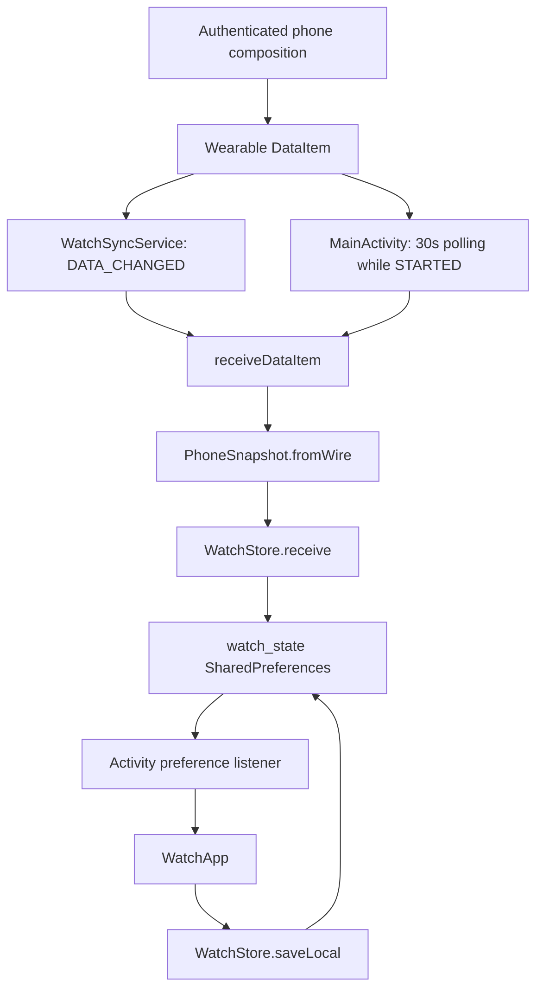

# Companion architecture and protocol

Return to the [handoff index](README.md).

## Data flow

The app is Kotlin/Compose with one Android application module. There are no ViewModels, navigation framework, Room database, HTTP repository, WorkManager jobs or backend synchronization credentials. `WatchState` is pure Kotlin rules; `WatchStore` owns persisted state; the service and activity reconcile incoming snapshots; Compose owns transient screen selection.

The service receives changed DataEvents even without an open activity. The activity polls already-stored DataItems every 30 seconds inside `repeatOnLifecycle(STARTED)` and releases buffers. Retrieval failures leave the cache available. Its SharedPreferences listener reloads the entire store; it reads once after listener registration to close the initialization gap. The service ignores DataItem deletions; clearing is an explicit inactive snapshot.

## Schema 1 message

The DataItem path must be exactly `/unspoken-cues/state`. Manifest filtering uses a path prefix, but the parser performs exact equality. The sender uses DataClient `putDataItem` with urgency; it is latest state, not a complete event stream.

| Field | Type | Validation/meaning |
| --- | --- | --- |
| schema | Int | Must equal 1 |
| active | Boolean | false → clear cue and profile |
| status | String | Active must be GREEN/YELLOW/RED/PURPLE; unknown rejects snapshot |
| name | String | At most 80 characters retained |
| token | String | SharedProfile link only exists for exactly 32 hex characters |
| public | Boolean | Share UI requires true and a valid link |
| revision | Long | Must be positive and pass generation ordering |
| publisher | String | Must be nonblank, not retired |

Phone sends no email, session, Auth credential, profile preferences/boundaries, image or account UUID. The card token is still sensitive as a sharing capability. `SharedProfile.link` lowercases it into `unspokencues://card/<token>`. Public active data without a valid token retains the cue but discards the profile; private data may retain a name but cannot produce `WatchState.shareLink`. Inactive data clears both irrespective of other fields.

The phone gates publishing on a confirmed session, correctly loaded profile and completed onboarding. It submits immediate changes and retries unchanged content every 30 seconds while its root composition lives. Same-account loading can preserve watch cache; confirmed different-account loading sends clear. Sign-out sends clear after definite session state. It is not a guaranteed phone background worker. The pill on the phone counts connected nodes rather than application receipts.

## Ordering and persistence

Phone keeps `watch_publisher` preferences containing current fields, revision and random generation UUID. Changed content gets `max(currentTimeMillis, previous + 1)`; unchanged retries keep the same revision. Reset/reinstall creates a new publisher because those preferences are excluded from backup/transfer.

Watch `watch_state` stores status, has_profile/name/token/public, locked, received, revision, publisher and retired_publishers. Store operations synchronize on a common monitor. `SnapshotOrder` accepts a new unseen non-retired generation even at a lower revision; it accepts the current generation only at a strictly higher revision. A generation switch retires the previous one permanently in this cache. Delayed retired data cannot restore an old identity. This assumes one logical phone owner; simultaneous publisher arbitration is not implemented.

Accepted receive persists the full state, records local receipt time and relocks the cue. A local save only changes status/lock and only when UI revision/publisher still match the stored values. This prevents stale UI callbacks from overwriting newer phone state. Equal/old snapshot retries do not override a locally selected color. Manual phone Sync now does not force a new revision for unchanged content.

Watch backups are disabled and shared preferences additionally excluded from extraction/transfer. Clearing watch app data loses the cache, retired-generation history and local color. The activity can recover current DataItems on restart if available; it cannot obtain a fresh backend state independently.

## UI state machine

`WatchApp` saves a private Screen enum: STATUS, OPTIONS, GUIDE, UNLOCK, SELECT, SHARE. A changed publisher/revision returns to STATUS. New phone data also relocks via the store.

- STATUS fills the display with one cue and shows symbol/name/meaning plus Options. Before sync it explains Waiting for phone.
- OPTIONS offers sharing, Color locked/Change color, Cue guide and last received local time. No accidental swipe/bezel cycling is implemented.
- UNLOCK requires a separate confirmation. Selecting a cue is ignored while locked; valid unlocked selection immediately relocks and persists locally.
- SELECT uses neutral buttons rather than displaying all four saturated cues together. Cancel and system Back relock and return to status.
- SHARE is available while locked when a public valid token exists. QR closes after 30 seconds, Close or Back. A new phone revision closes obsolete QR immediately.
- GUIDE shows all cue names/meanings/symbols on neutral background. System navigation is not intercepted for status-changing gestures.

Cue definitions mirror the phone: Green `#2E9E5B`/check, Yellow `#E8B517`/triangle, Red `#CF3A2D`/stop, Purple `#7B4FC9`/question. Foreground is dark on Green/Yellow and near-white on Red/Purple. Screen reader semantics combine cue label, full meaning and symbol; decorative shapes avoid duplicate announcements. Columns scroll for large text/round displays.

QR uses ZXing error correction M, black on white, four quiet modules per edge and integer-sized cells. It opens a custom link understood by the phone app, not a public web profile. No full-brightness override or always-on watch face is implemented.

## Privacy and reliability limits

Disconnected cache remains until a newer clear/private snapshot arrives. Setting Private on the phone withholds the token in new snapshots but does not remotely erase an offline device. The backend swap RPC accepts existing valid tokens even for private profiles, and tokens have no expiry/revocation flow. Existing swaps can read private profile rows. Do not promise immediate revocation.

There is no watch-to-phone write, conflict resolver, application receipt, transport integration harness or multi-phone owner selector. A newer phone content snapshot replaces a local color even while locked. Local locking protects against accidental watch interaction, not phone updates. See the [testing and troubleshooting guide](testing.md) before changing these semantics.
